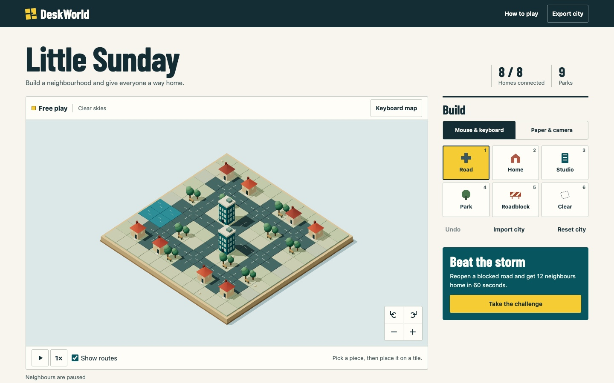

# DeskWorld

**[Play DeskWorld in your browser](https://izhechev.github.io/deskworld/)**. You can start with a mouse and turn on the camera when you want to try the paper controls.

A little city you can change with your mouse or coloured paper pieces. Build roads, move buildings, and watch twelve neighbours find a way home.

DeskWorld is a browser-based prototype built around a small 3D neighbourhood. The city, simulation, and paper detector run on your device.



## Run it

Python 3 is enough to run the checked-in app:

```sh
python3 -m http.server 8806 --bind 127.0.0.1 --directory dist
```

Open [localhost:8806](http://127.0.0.1:8806). On macOS, you can also run `Start DeskWorld.command` from Finder.

For development, use Node.js 22 or later:

```sh
npm ci --ignore-scripts
npm run build
npm test
npm run format:check
npm start
```

The build copies the pinned Three.js modules and license into `dist/vendor`; no CDN, API key, or backend is needed at runtime.

## Try these three things

1. **Change a route.** Select Roadblock and place it on a road; neighbours replan their routes or wait if no path exists. Undo restores the previous tile.
2. **Beat the rain.** Select Take the challenge; replace a roadblock on row 4 with a road, then get all twelve neighbours home within 60 simulation seconds.
3. **Move some paper.** Select Paper & camera, then Try paper demo; drag the three pieces in the preview and watch the city change.

Mouse controls and a keyboard map are both available. Use keys 1–6 to choose a piece outside dialogs; in the map, use arrow keys to move and Enter to place it. The view has rotation and zoom buttons.

## Use a real camera

Select **Use my camera** and grant camera permission. Use a camera facing straight down at a plain square board, aligned with the preview; a laptop webcam may need an external mount or another camera for this setup.

| Paper colour        | City piece |
| ------------------- | ---------- |
| Coral or bright red | Home       |
| Green               | Park       |
| Blue                | Roadblock  |

The central square of the camera image maps to the whole 11 × 11 city; its top edge is row 1. Use pieces around one grid cell wide, keep the camera still, and avoid strongly coloured backgrounds. Lighting and paper colours affect detection.

The detector uses HSV colour ranges and connected components, then waits for three stable frames before adding a piece. Missing pieces remain for up to 750 ms to reduce flicker. This version does not correct camera perspective or recognise arbitrary objects.

Live pieces are a temporary layer. **Keep these pieces** adds them to the editable city; **Stop input** removes the layer and stops the camera. No audio is requested, and frames are not recorded or uploaded. Hiding the tab stops a real camera session.

The synthetic paper demo and detector tests have been checked; detection quality with a physical camera and paper has not yet been verified.

## What is simulated

Each neighbour travels from a studio to a home. Four-direction breadth-first search finds a shortest route over equal-cost road tiles; people cannot walk through unrelated buildings, parks, or water.

A changed road triggers replanning from the last completed tile. This can cause a small visual snap when a change happens during a step. Free play starts a new group after everyone arrives.

The storm challenge starts from a fixed neighbourhood with road works. Homes and studios are fixed during the challenge; a successful repair lets waiting neighbours continue. The timer uses simulation time, so pause, open dialogs, and hidden tabs stop it, while 2× speed advances it twice as fast.

This is a playable experiment, not a traffic, weather, or urban-planning forecast.

## Saving

Edits in free play are saved to browser storage when available. Export a JSON city to keep a portable copy; Import validates the format and limits files to 20 KB. Challenge layouts do not replace the saved sandbox city.

## Code structure

- `dist/js/world.js` — map rules, routing, simulation, and city-file validation
- `dist/js/vision.js` — colour detection, stable tokens, and camera lifetime
- `dist/js/scene.js` — 3D objects, lighting, view controls, and pointer picking
- `dist/js/app.js` — user actions, session state, persistence, and the animation loop
- `tests/` — routing, challenge outcomes, input validation, detection, and camera cleanup

The pure simulation and vision functions do not depend on the page or renderer. Camera access is injected into a small session object so late permissions and cleanup can be tested without a device.

See [design decisions and sources](docs/DECISIONS.md) and [validation notes](docs/VALIDATION.md).

## Inspiration and dependencies

[MIT CityScope](https://cityscope.media.mit.edu/) explores tangible interfaces for urban questions. DeskWorld takes that idea into a small browser playground with a storm challenge and simple coloured-paper controls.

The renderer uses [Three.js](https://threejs.org/); its MIT license is included in `dist/vendor/THREE-LICENSE.txt`. All buildings and trees are procedural geometry.
